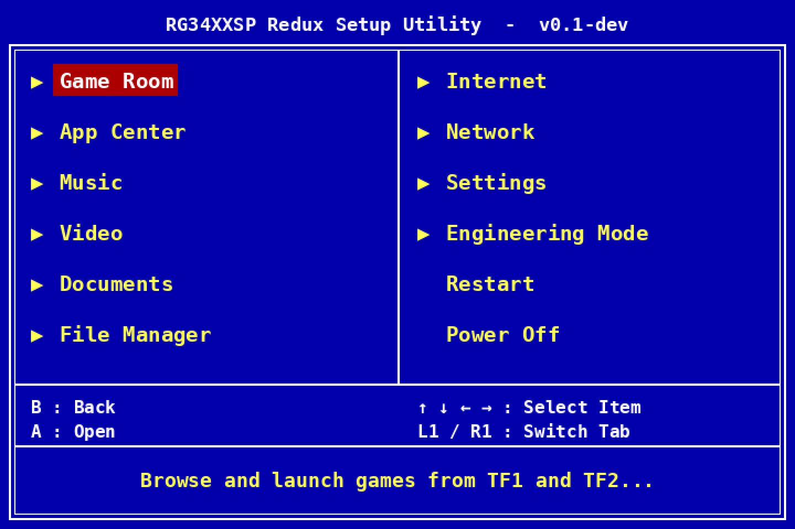
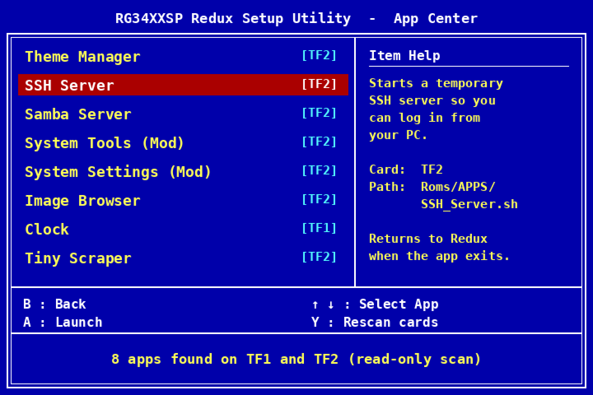
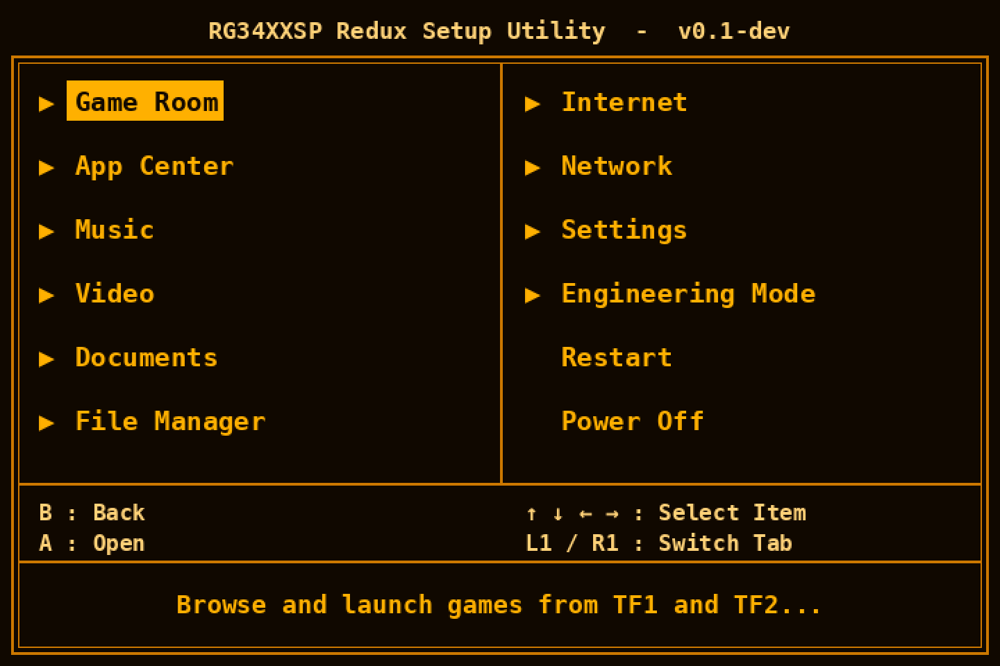
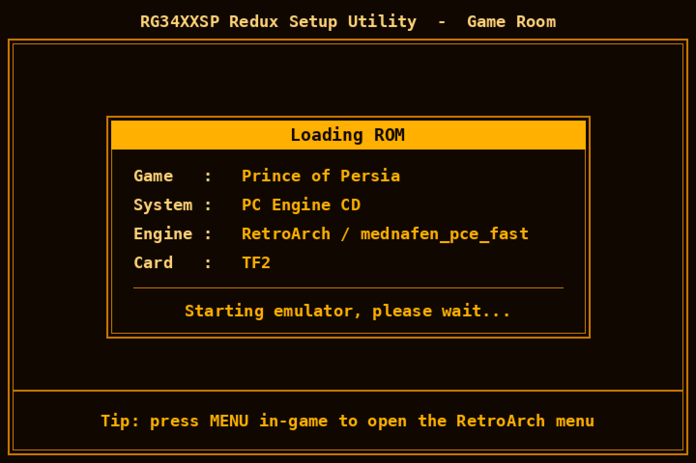

# Anbernic RG34XXSP Redux

An operating system for the Anbernic RG34XXSP that lets the hardware perform the way it was designed to, without pushing it past its limits.

[](https://github.com/wilcox101-maker/Anbernic_RG34XXSP_Redux/actions/workflows/ci.yml)
[](https://github.com/wilcox101-maker/Anbernic_RG34XXSP_Redux/releases)
[](LICENSE)

Redux is a replacement menu (C/SDL2) for the stock firmware. It **replaces only the stock launcher**:
the stock Ubuntu, kernel and emulators stay as they are, and nothing is reflashed. Your games, saves
and BIOS files stay where stock keeps them.

- **Inside the factory envelope by default:** the chip's own CPU and GPU speed tables (max 1512 MHz)
  and the stock thermal trip points. No overclocking or undervolting out of the box.
- **Removes what stock wastes:** input latency, a CPU pinned at full speed, an ignored lid sensor.
- **Stability first:** your ROM cards are never written by Redux's own code, and stock is one command away.

## Quick start

**You need:** an RG34XXSP on its stock firmware and your Wi-Fi, SSH switched on with its root
password, and a PC with Python 3 and `ssh` (built into Windows 10 and 11). Details, including the
tested firmware and hardware revision: [docs/install.md](docs/install.md).

1. From the [dev release](https://github.com/wilcox101-maker/Anbernic_RG34XXSP_Redux/releases/tag/dev),
   put `dmenu.bin`, `install.py`, `redux_install.sh` and `run.sh` in one folder.
2. In that folder:
   ```
   python install.py --check 192.168.1.13    # looks only
   python install.py 192.168.1.13            # installs, then restart the handheld
   ```
3. **Undo:** `python install.py --uninstall 192.168.1.13`, or on the device *Settings → System → Stock Menu*.

The installer's check, install, upgrade and uninstall were device-checked on 2026-11-16
([result](notes/2026-11-16-dale-hw-result-185.md)). Builds are pre-Beta; there is no tagged release yet.

## Screenshots

<!-- DEMO GIF: a real device capture goes here (10-20 s: menu → launch → lid sleep), recorded with
     tools/capture_demo.py in Dale's next device session. Until then, the concept renders below stay,
     labelled as renders. -->

<p align="center">
  
  
  <br>
  
  
</p>

*Concept renders of the BIOS-style UI (not screenshots of the current build), at the device's native
720×480. The real screens follow the text mock-ups in [`docs/ui-spec.md`](docs/ui-spec.md). More
renders, the colour presets and the boot screen: [docs/developer.md](docs/developer.md),
[`branding/`](branding/README.md).*

## Status

**Beta (v0.5) ≈ 60%:** frontend phases F0–F5 are signed off on the device; F6, the Phase 1
measurements and the Beta exit test remain. **1.0** (mainline kernel) is research and design; nothing
has booted on mainline yet. Plan and detail: [ROADMAP.md](ROADMAP.md) · live task list:
[notes/STATUS.md](notes/STATUS.md).

**Device-checked** in this repo means Dale ran it on a real RG34XXSP and a result note in
[`notes/`](notes/) records it. Everything else is merged and passes CI but is not yet confirmed on hardware.

## Documentation

- [Install, back to stock, compatibility](docs/install.md)
- [User guide and troubleshooting](docs/user-guide.md)
- [Developer guide: repo layout, PC tools, hardware](docs/developer.md)
- [Third-party notices](THIRD-PARTY-NOTICES.md)

## Safety

- Redux never formats a partition and never writes to the device's bootloader region.
- Redux's own code never writes to your ROM cards. The stock engines it launches (RetroArch, OpenBOR)
  keep saving there exactly as on stock.
- Only flash a **spare** SD card if you try the Phase 1 kernel tweaks; keep the stock card untouched.
- No ROMs, BIOS files or Anbernic binaries are in this repo or its releases.

*Not affiliated with or endorsed by Anbernic. Device names are used only to identify compatible hardware.*

## How Redux became possible

Redux is one person's project, built with an AI partner. Dale owns the hardware, every decision, and
every device test: nothing here is called device-checked unless it ran on his RG34XXSP and has a
result note in `notes/`. The heavy lifting of deep code and firmware analysis was done with
**Claude (Anthropic), mainly Claude Opus 5.5**:

- reverse engineering the stock firmware: boot chain (boot0, BL31, u-boot), DRAM parameters, kernel
  symbols and modules, device-tree differences, the stock launcher and daemons;
- research for the mainline path, in the companion
  [H700 kernel research repo](https://github.com/wilcox101-maker/Allwinner-H700-Custom-Kernel-Research):
  u-boot and kernel patches, reproducible builds, QEMU tests;
- writing and reviewing the frontend, installer, CI and documentation.

**By the numbers (2026-11-09 → 2026-11-17, 9 days):** about 1,070 commits and 270 merged pull requests
across the two repos; about 23,000 lines of code, scripts, patches and device trees; about 180,000
words of research notes and documentation, including about 40 separate firmware and hardware analyses.

**Estimated solo effort: about 2,100 hours, roughly a full working year,** for one experienced
embedded engineer working alone:

| Work | Basis | Hours |
|---|---|---|
| Code (frontend, installer, tools, u-boot/kernel patches, DTs, CI) | ~23,000 lines at ~20 designed, debugged and tested lines/hour | ~1,150 |
| Firmware and hardware analysis | ~40 analyses (R1–R25, Ghidra G/W waves, stock boot and userspace) at ~20 h each | ~800 |
| Writing it up (user and developer docs not counted above) | | ~150 |
| **Total** | | **~2,100** |

It's an estimate, not a measurement; the basis is shown so you can check it. What it does not replace:
opening the case, running the tests, and deciding what is safe for the hardware.

## License

GPL-2.0. The reference device tree and kernel config come from GPL-2.0 kernel sources. The artwork in
[`branding/`](branding/) (mark and boot screen) is CC BY 4.0, see [`branding/README.md`](branding/README.md).
Fonts and other third-party parts: [THIRD-PARTY-NOTICES.md](THIRD-PARTY-NOTICES.md).
