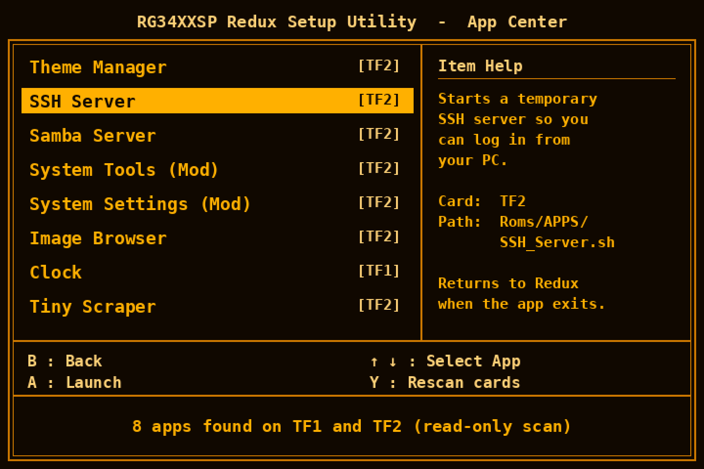
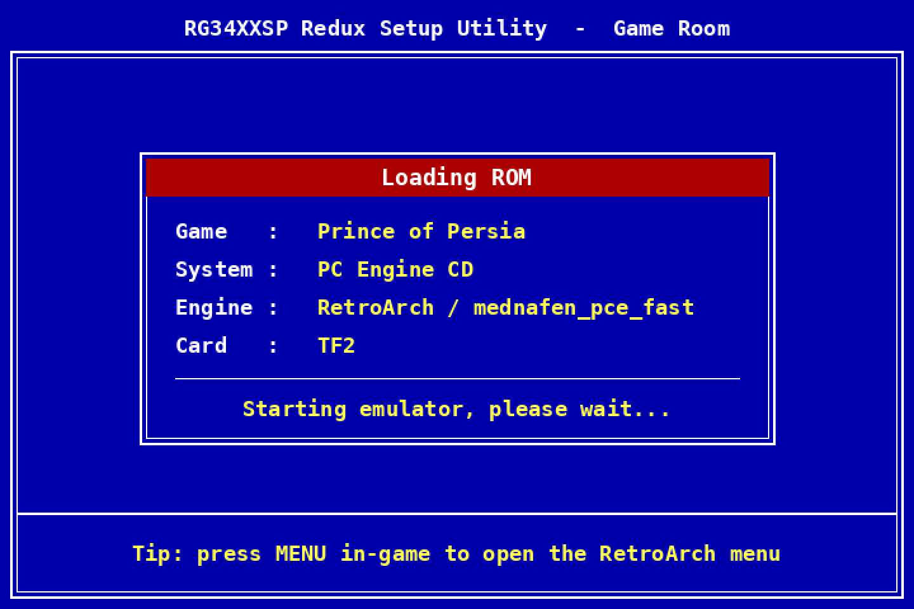
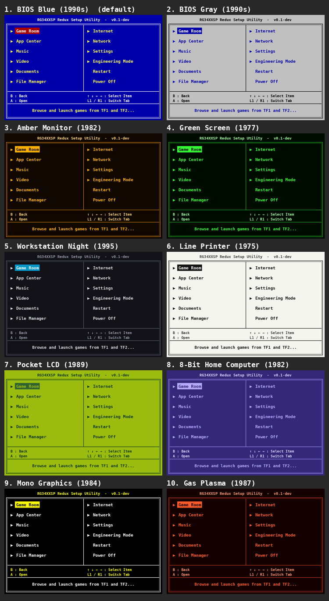
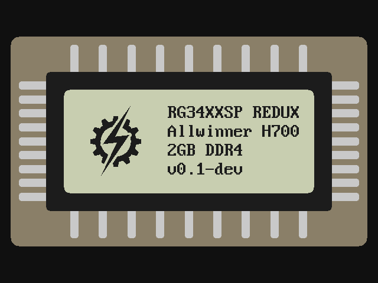

# Anbernic RG34XXSP Redux

An operating system for the Anbernic RG34XXSP that lets the hardware perform the way it was designed to, without pushing it past its limits.

**Principles**

- **Stay inside the factory envelope by default.** No overclocking, no undervolting out of the box. Redux uses the chip's own CPU and GPU speed tables (max 1512 MHz) and the stock thermal trip points. Tinkerers will later be able to go further through a deliberately hard-to-reach **Expert Mode** with automatic fallbacks; it is not part of Beta. The thermal emergency shutdown is never touched.
- **Remove what the stock OS wastes.** That covers input latency, a CPU pinned at full speed, ignored hardware (the clamshell lid sensor, the fuel gauge), slow boots, and filesystems that can corrupt.
- **Stability first.** In 1.0 the system image is read-only and runs from RAM. User data is journaled with write barriers on. The stock SD card always stays a working fallback.

## The Redux frontend (in development)

> **Status: pre-Beta dev builds.** A PC installer ([`tools/install.py`](tools/install.py), [guide](docs/install.md)) checks, installs, upgrades and uninstalls back to stock over SSH; all four were device-checked on 2026-11-16. Builds come from the `dev` release; there is no tagged release yet.

The first piece of Redux is a lightweight C/SDL2 menu that **replaces only the stock launcher**. The stock Ubuntu 22.04, kernel and emulators stay as they are. There's no reflash, and it can be undone from the device itself.

<p align="center">
  
  
  <br>
  
  
</p>

<p align="center">
  
  
</p>

*Concept renders of the BIOS-style UI (not screenshots of the current build), at the device's native 720×480, in BIOS Blue (default) and Amber Monitor: the main menu, App Center, and the Loading ROM screen shown while the emulator starts. The real screens follow the text mock-ups in [`docs/ui-spec.md`](docs/ui-spec.md).*

### Why it's different (the goal)

| | Redux frontend | Typical custom firmware |
|---|---|---|
| **Install** | Replaces only the stock menu program, from your PC in one command | Reflash a whole OS image |
| **Undo** | `install.py --uninstall`, or *Settings → System → System Defaults → Stock Menu* on the device | Reflash stock |
| **Your existing setup** | Keeps stock RetroArch configs, saves, BIOS files and Stock OS Mod tools | Usually rebuilt from scratch |
| **Game cards** | Redux's own code never writes to, formats or resizes your ROM cards. The stock engines it launches (RetroArch, OpenBOR) keep saving there exactly as on stock, and Redux asks RetroArch to flush its saves before a lid sleep | Varies |
| **Look** | Retro BIOS-setup interface: 4 accent colours plus the 16-colour VGA palette, and 5 UI fonts, changed on the device | Theme packs |
| **Branding** | The boot screen comes from plain files in [`branding/`](branding/) | Usually hard-coded |
| **For tinkerers** | Engineering Mode: live CPU, GPU, battery, thermal, storage and log read-outs; CPU governor, speeds and cores, always inside the chip's own tables; a heat guard | Rarely built in |
| **Footprint** | One ~250 KB program (it carries its two small helpers); about 0% CPU idle in the menu (measured 2026-11-10) | Full frontends |

### Colour presets

The build has four accent colours (BIOS cyan, Amber, Green, White) plus the 16 standard VGA text
colours (all but black) under *Settings → UI*, and five UI fonts under *Settings → Display → Font*. The
full design is ten schemes named after the displays of 1975 to the 1990s (below, a design render); those
are not built yet.

<p align="center"></p>

### Redux boot screen

<p align="center"></p>

A chip-on-socket design carrying the Redux gear-and-bolt mark (Dale, 2026-11-11). Original artwork,
**CC BY 4.0** ([`branding/mark.svg`](branding/mark.svg)); no Anbernic logo or assets.

- **Make your own:** edit [`branding/boot.ini`](branding/boot.ini) (colours, label text, version line) and
  `mark.pbm`, then run `python tools/make_bootlogo.py`. It writes a 640×480 BMP in the stock format. No
  code changes; see [`branding/README.md`](branding/README.md).
- **Install and restore on the device:** *Settings → System → Boot Screen* installs it and keeps a
  backup of the stock logo, and restores that backup. If the menu is out of reach, there is a one-line SSH
  restore in [`docs/install.md`](docs/install.md#boot-logo-by-hand).
- **Device-checked:** install on 2026-11-13 ([result](notes/2026-11-13-dale-hw-result-boot-screen.md));
  install, restore and the SSH restore on 2026-11-16 ([result](notes/2026-11-16-dale-hw-result-185.md), checks 29-30).

*Not affiliated with or endorsed by Anbernic. Device names are used only to identify compatible hardware.*

## Project status

*Updated 2026-11-17. **Device-checked** means Dale has run it on a real RG34XXSP and a result note in
[`notes/`](notes/) records it. Everything else is merged and passes CI but hasn't been confirmed on
hardware yet. Live task list: [`notes/STATUS.md`](notes/STATUS.md). Full plan: [`ROADMAP.md`](ROADMAP.md).*

| Milestone | What it is | Progress (rough) |
|---|---|---|
| **Beta (v0.5)** | Redux frontend on the stock kernel, installable by anyone | ≈ 55% |
| **1.0** | Purpose-built OS on a mainline kernel | ≈ 20% (research and design; nothing booted on mainline yet) |
| **1.x** | After 1.0: ZRAM on mainline | not started |

*How the Beta number is made: the Beta work is weighted by effort (F0-F2 25, F3 10, F4 10, F5 10, F6 15,
installer 10, Phase 1 measurements 5, user docs 5, exit test and releases 10). Done: F0-F4, about 60% of
F5, installer A, part of the docs. It was ≈ 40% on 2026-11-14, before F3 and F4 were signed off.*

### Latest (2026-11-16)

- **Device session #185** (dev `5d7dea6`): 27 of 30 checks passed, including the installer (check,
  install, upgrade, uninstall) and the start-failure guard ([result](notes/2026-11-16-dale-hw-result-185.md)).
- **F3 signed off:** five UI fonts and Reset All ([sign-off](notes/2026-11-16-dale-phase-gate-f3-signed-off.md)).
- **F4 signed off:** lid sleep in the menu and in games, governor restore after a game, the menu dims after
  60 s. Exit test: 50 lid cycles mid-game on `6d87953`, all slept and woke; save-before-sleep timing waived by
  Dale ([sign-off](notes/2026-11-16-dale-phase-gate-f4-signed-off.md)).
- **Game Room TF1/TF2 card picker**, device-checked with the cache crash fix (#216)
  ([result](notes/2026-11-16-dale-hw-result-f4.md)).
- **F5 Engineering Mode under way:** live read-outs and the safety net (logged writes, saved profile) are
  device-checked on `d334375` ([result](notes/2026-11-16-dale-hw-result-f5-steps-1-2.md)). CPU controls,
  the heat guard (caps the CPU at 75 °C, powers off at 90 °C) and the GPU, Storage and Logs tabs are built,
  not device-checked.
- **Research:** H700 project findings landed in Redux (#223): stock sleep is run by the BL31 firmware with
  no SCP firmware, Wi-Fi is not a wake source, and the stock `loadapp.sh` formats p1/p7/p8 at boot if they
  can't be mounted, so Redux must never leave them unmountable. Mainline work for 1.0 is in
  [`docs/kernel-research/`](docs/kernel-research/README.md) (desk research; nothing booted yet).

### Completed
- **Phase 0, dissect stock:** partitions, boot chain, hardware map, stock userspace inventory.
- **Phase 1, stock-kernel baseline:** patched `boot.img` (5 ms input polling, `schedutil` governor,
  write barriers). Boots to the menu in about 20 s on the device (2026-11-10).
- **Frontend F0-F4 signed off:** UI spec, desktop prototype, launch parity with the stock menu, settings
  parity (F3), power and lid (F4).
- **Device-checked features:**
  - Game launching through stock RetroArch (PS1, Neo Geo, CPS, Saturn and others), PSP, **MAME** and
    **OpenBOR** (Contra on TF2, saves on TF1); back to the same game list after quitting. Another 27
    system folders are mapped; not every one has been run on the device
  - Game Room card picker (TF1/TF2); games on TF2 launch
  - Installer A from the PC (check, install, upgrade, uninstall to stock) and the start-failure guard
    (three quick failures fall back to the stock menu)
  - BIOS-style UI: colour presets (Amber kept across a reboot), 5 UI fonts, Reset All; brightness, volume
    and Screen Timeout kept
  - Lid sleep and wake in the menu and in games; governor restored after a game; menu dimming
  - Wi-Fi setup with a full on-screen keyboard
  - **Redux boot screen:** install, restore, and the SSH restore
  - Card Scripts: `.sh` ports on either card always listed and run when picked (#200)
  - Apps: Terminal, Task Monitor (htop), Music, Ebook Reader, five Tools apps; File Manager on Main; Apps
    resume where you left off. The Video Player plays through, but takes no buttons during playback (a
    Redux front-end is planned in F6)
  - System Tools, Restart/Power Off with a 3 s hold, restore the stock menu from Settings
  - `tools/extras.py`: optional Ubuntu extras (htop) from a checklist, one SSH line

### In progress (merged, waiting for a device check)
- **F5 Engineering Mode:** CPU controls (governor, min/max, cores 1-3), the heat guard, GPU, Storage and
  Logs tabs, battery time left. Still to build: input viewer, LED and rumble test, a check-only filesystem
  check (`fsck -n`)
- Not yet run on the device: lid during Restart/Power Off from the menu, a ROM copied from the PC showing
  after restart, start-up time with the ROM cache
- Open device checks are listed in [`notes/STATUS.md`](notes/STATUS.md)

### Next (to reach Beta)
- F5: finish and Dale's sign-off (exit test: 30 min at full load on the charger)
- F6: Wi-Fi off unless needed, a Power & Lid settings page, Redux front-ends for the stock Video Player,
  Music, Ebook Reader and File Manager
- Installer B: a TF2 package installed from the device
- Phase 1 measurements, stock vs. Redux: boot time, idle battery drain, temperature, button latency
- User docs; Beta exit test: one week of daily use with no lost save; tagged `v0.5-beta.N` releases

### Future
- **1.0, mainline:** mainline kernel and u-boot, a read-only system that runs from RAM, lid wake,
  then the frontend checklists passed again on the new OS, and an install/update path
- **1.x:** ZRAM (compressed RAM swap) on mainline
- **Backlog:** Update option in Settings, DOS menu layout and a switch for it, a custom boot image picked
  on the device, Game Room Favorites, Expert Mode (above-factory settings behind an unlock), PC link
  (browser file manager), chiptune composer, vsync rebuilds of stock apps that tear, hardware video
  decode, in-game HUD

## Hardware at a glance

| | |
|---|---|
| SoC | Allwinner H700 (H616 family, `sun50iw9`), 4× Cortex-A53 @ up to 1.512 GHz, Mali-G31 (420-648 MHz) |
| RAM | 2 GB (the device tree's 512 MB memory node is a template that u-boot overwrites) |
| PMIC | X-Powers AXP2202 (fuel gauge, USB-C, power key; its battery temperature is a fixed dummy) |
| Display | 720×480 parallel RGB, about 59.16 Hz (exactly 3× GBA, 3× GB vertical) |
| Lid | Hall sensor on **PE7**, reported as keys on `axp2202-pek` |
| Wi-Fi/BT | Realtek RTL8821CS (SDIO) |
| Stock kernel | Linux 4.9.170 (Allwinner BSP), built 2025-04-12 |

The details are in [`docs/hardware-map.md`](docs/hardware-map.md).

## Repo layout

```
AGENTS.md, CLAUDE.md  rules for AI collaborators; they talk through notes/
notes/                dated notes (decisions, device results, sign-offs) + STATUS.md board
frontend/             the Redux menu (C/SDL2), its helpers, tests and mock-up checks
installer/            device-side install script and run.sh
branding/             boot screen, mark and colours (CC BY 4.0 artwork)
docs/                 hardware map, stock boot chain and userspace, UI brief and spec, install and user guides
docs/kernel-research/  kernel, bootloader and Ubuntu research (desk only)
reference/stock-202505/  device tree source, kernel .config, u-boot env and
                      initramfs init script, extracted from Anbernic firmware
                      rg34xxsp-fw-sd_202505 (sources only, no binaries)
tools/                PC tools (pure Python 3, no dependencies)
phase1-stock-tweaks/  baseline patch set on the stock kernel
phase2-mainline/      mainline kernel + rootfs build (planned)
```

## Tools

All of them are standard-library Python 3 and run on Windows, WSL or Linux.

| Tool | What it does |
|---|---|
| `tools/install.py` | Install, upgrade, check or uninstall Redux on a stock card over SSH ([guide](docs/install.md)). |
| `tools/make_bootlogo.py` | Render the boot screen from `branding/` into a stock-format 640×480 BMP, or check one. |
| `tools/extras.py` | Pick optional Ubuntu extras from a checklist and get the one-line SSH install. |
| `tools/precheck.py` | Run the CI checks that matter for what you changed, before you push. |
| `tools/log_activity.py` | Append one line to `notes/ACTIVITY.md` on main (the agents' log). |
| `tools/bootimg.py` | Unpack and repack Android boot images (v0-v2). Verified to rebuild the stock `boot.img` **byte-for-byte**. |
| `tools/initramfs.py` | Unpack and repack the gzip'd cpio initramfs, keeping ownership, modes and symlinks in a manifest so a Windows checkout can't lose them. |
| `tools/dt_keys.py` | Print the button → GPIO pin → Linux event map from a device tree. |
| `tools/fdt_patch.py` | Read or overwrite a u32 property in a compiled `.dtb` in place (no `dtc` needed). |
| `tools/stock_inventory.py` | Read-only inventory of `RG34XXSP.img` with no mounting. Never reads the Roms partition. |

```bash
python3 tools/install.py --check 192.168.1.13     # what is installed?
python3 tools/install.py 192.168.1.13             # install or upgrade
python3 tools/install.py --uninstall 192.168.1.13 # back to the stock menu
```

## Safety

- Only flash a **spare** SD card. Keep the stock card untouched.
- Nothing here writes to the device's bootloader region (boot0/u-boot in the first 36 MiB of the card).
- Redux never formats a partition, and never leaves p1, p7 or p8 unmountable: the stock start-up script
  formats them without asking if it can't mount them.
- **Never commit ROMs, BIOS files, or the stock image itself.** `.gitignore` blocks the common cases.

## License

GPL-2.0. The reference device tree and kernel config come from GPL-2.0 kernel sources. The artwork in
[`branding/`](branding/) (mark and boot screen) is CC BY 4.0, see [`branding/README.md`](branding/README.md).
