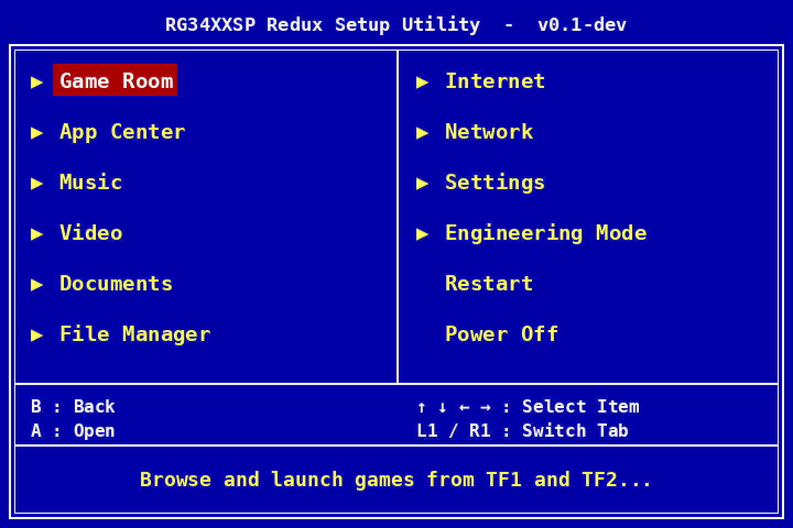
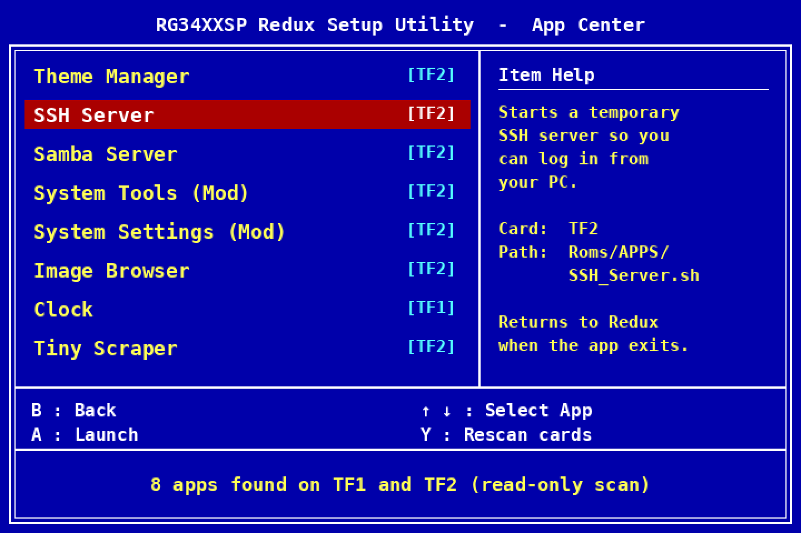
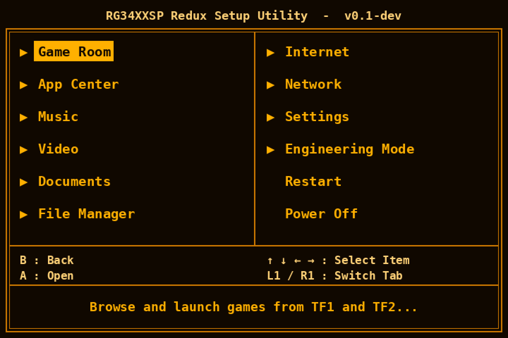
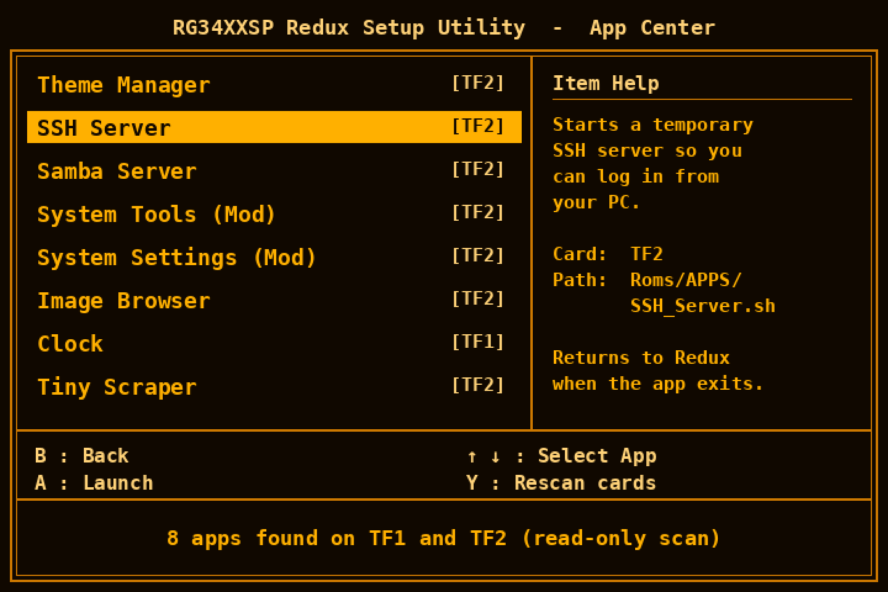
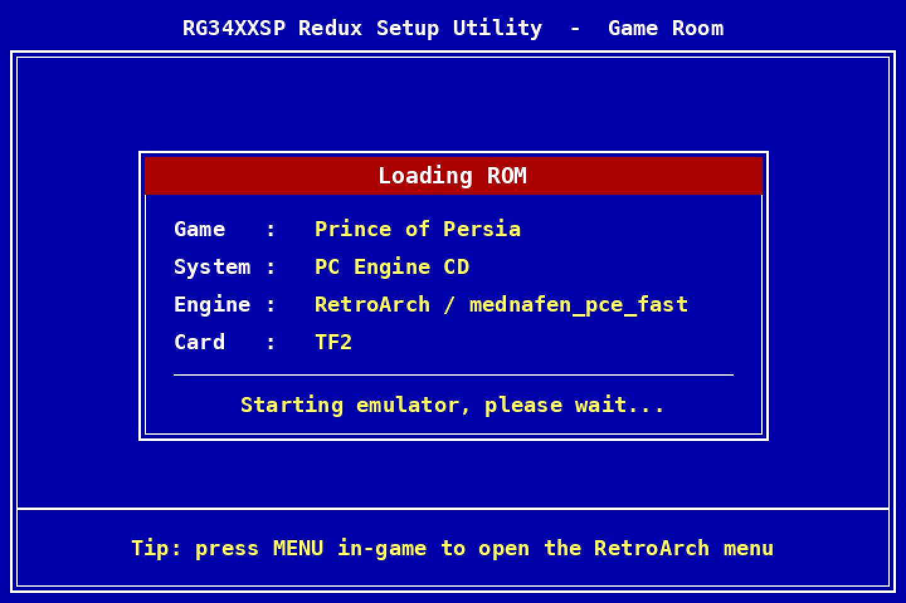
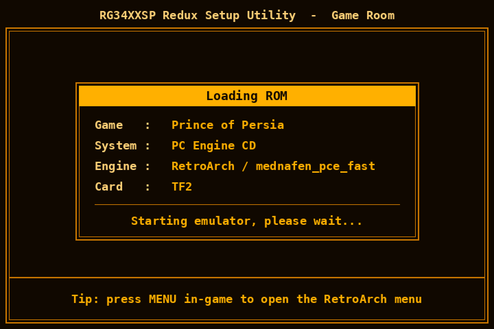
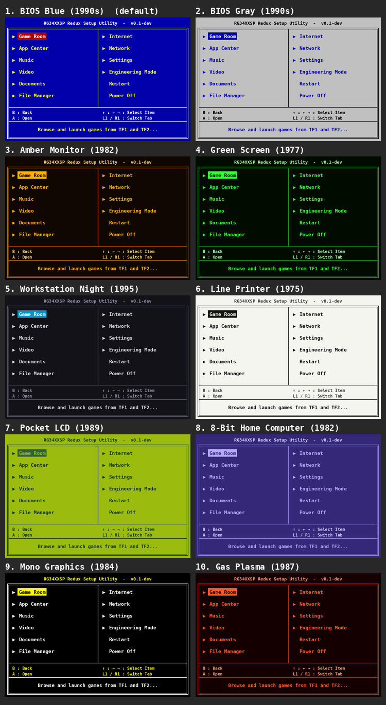

# Anbernic RG34XXSP Redux

An operating system for the Anbernic RG34XXSP that lets the hardware perform the way it was designed to, without pushing it past its limits.

**Principles**

- **Stay inside the factory envelope by default.** No overclocking, no undervolting out of the box. Redux uses Allwinner's own bin-aware CPU frequency table (max 1512 MHz) and the stock thermal trip points. In the open-source spirit, tinkerers can go further through a deliberately hard-to-reach **Expert Mode** with automatic fallbacks. The thermal emergency shutdown is never touched.
- **Remove what the stock OS wastes.** That covers input latency, a CPU pinned at full speed, ignored hardware (the clamshell lid sensor, the fuel gauge), slow boots, and filesystems that can corrupt.
- **Stability first.** The system image is read-only and runs from RAM. User data is journaled with write barriers on. The stock SD card always stays a working fallback.

## The Redux frontend (in development)

> **Status: early development, no release yet.** Builds are for testers comfortable with SSH. A packaged installer comes later.

The first piece of Redux is a lightweight C/SDL2 menu that **replaces only the stock launcher**. The stock Ubuntu 22.04, kernel and emulators stay as they are. There's no reflash, and it can be undone from the device itself.

<p align="center">
  
  
  <br>
  
  
</p>

<p align="center">
  
  
</p>

*Concept renders of the **planned** BIOS-style UI (not the current screens), at the device's native 720×480, in BIOS Blue (default) and Amber Monitor: the main menu, App Center, and the Loading ROM screen shown while the emulator starts.*

### Why it's different (the goal)

| | Redux frontend | Typical custom firmware |
|---|---|---|
| **Install** | Replaces only the stock menu program | Reflash a whole OS image |
| **Undo** | *Settings → System → System Defaults → Stock Menu* restores the stock launcher from the device | Reflash stock |
| **Your existing setup** | Keeps stock RetroArch configs, saves, BIOS files and Stock OS Mod tools | Usually rebuilt from scratch |
| **Game cards** | Read-only: never writes to, formats or resizes your ROM cards | Varies |
| **Look** | Retro BIOS-setup interface with 10 colour presets, changeable on the device (planned) | Theme packs |
| **Branding** | Boot screen and colours come from plain `.ini` files in [`branding/`](branding/) | Usually hard-coded |
| **For tinkerers** | Engineering Mode tabs (CPU, battery, thermal) today; System Tools and htop planned | Rarely built in |
| **Footprint** | One ~56 KB binary; measured at ~0% CPU while idle in the menu | Full frontends |

### Colour presets

Ten built-in schemes named after the displays of 1975 to the 1990s. Pick one under *Settings → UI → Colors*, or add your own in `branding/theme.ini`.

<p align="center"></p>

### Frontend status

**Working today:**
- Game list from both TF1 and TF2
- RetroArch launching: GB/GBC/GBA, Mega Drive, SNES/SFC, Master System/Game Gear, PC Engine, WonderSwan, PS1, Neo Geo, CPS and more
- PSP launching
- Returns to the same game list after you quit
- Wi-Fi setup with a full on-screen keyboard
- Engineering Mode tabs
- Restore the stock menu from Settings
- Rebrandable boot screen

**Next:**
- BIOS-style UI with colour presets
- System Tools
- App Center (runs `Roms/APPS` tools)
- htop
- Boot-logo installer
- Lid and power management

*Not affiliated with or endorsed by Anbernic. Device names are used only to identify compatible hardware.*

## Status

| Phase | Goal | State |
|---|---|---|
| 0 | Dissect stock firmware, map the hardware | **Done**: see [`docs/`](docs/) |
| 1 | Stock-kernel baseline: patched `boot.img` (input poll, governor, write barriers) | **Built**, awaiting on-device test |
| 2 | Mainline kernel + purpose-built rootfs (ROCKNIX H700 kernel work as base) | Planned |

The full plan is in [`ROADMAP.md`](ROADMAP.md).

## Hardware at a glance

| | |
|---|---|
| SoC | Allwinner H700 (H616 family, `sun50iw9`), 4× Cortex-A53 @ up to 1.512 GHz, Mali-G31 |
| RAM | 2 GB (the device tree's 512 MB memory node is a template that u-boot overwrites) |
| PMIC | X-Powers AXP2202 (battery fuel gauge, USB-C, power key) |
| Display | 720×480 parallel RGB, about 59.16 Hz (exactly 3× GBA, 3× GB vertical) |
| Lid | Hall sensor on **PE7** |
| Wi-Fi/BT | Realtek RTL8821CS (SDIO) |
| Stock kernel | Linux 4.9.170 (Allwinner BSP), built 2025-04-12 |

The details are in [`docs/hardware-map.md`](docs/hardware-map.md).

## Repo layout

```
AGENTS.md             rules for AI collaborators; they talk through notes/
notes/                dated hand-off notes between AIs + STATUS.md board
docs/                 hardware map, stock boot chain and userspace, kernel strategy, frontend brief
reference/stock-202505/  device tree source, kernel .config, u-boot env and
                      initramfs init script, extracted from Anbernic firmware
                      rg34xxsp-fw-sd_202505 (sources only, no binaries)
tools/                image tools (pure Python 3, no dependencies)
phase1-stock-tweaks/  baseline patch set on the stock kernel
phase2-mainline/      mainline kernel + rootfs build (planned)
```

## Tools

All of them are standard-library Python 3 and run on Windows, WSL or Linux.

| Tool | What it does |
|---|---|
| `tools/bootimg.py` | Unpack and repack Android boot images (v0–v2). Verified to rebuild the stock `boot.img` **byte-for-byte**. |
| `tools/initramfs.py` | Unpack and repack the gzip'd cpio initramfs, keeping ownership, modes and symlinks in a manifest so a Windows checkout can't lose them. |
| `tools/dt_keys.py` | Print the button → GPIO pin → Linux event map from a device tree. |
| `tools/fdt_patch.py` | Read or overwrite a u32 property in a compiled `.dtb` in place (no `dtc` needed). |
| `tools/stock_inventory.py` | Read-only inventory of `RG34XXSP.img` with no mounting: cuts the 36 MiB bootloader region, lists rootfs/appfs/UDISK through a built-in ext4 reader, and flags files that touch the CPU governor, kernel modules or power-key/lid handling. Never reads the Roms partition. |

```bash
python3 tools/bootimg.py unpack 3.boot.img work/boot
python3 tools/initramfs.py unpack work/boot/ramdisk work/initramfs
# ...edit...
python3 tools/initramfs.py pack work/initramfs work/boot/ramdisk
python3 tools/bootimg.py pack work/boot new-boot.img --pad-to 67108864
```

## Safety

- Only flash a **spare** SD card. Keep the stock card untouched.
- Nothing here writes to the device's bootloader region (boot0/u-boot in the first 36 MiB of the card).
- **Never commit ROMs, BIOS files, or the stock image itself.** `.gitignore` blocks the common cases.

## License

GPL-2.0. The reference device tree and kernel config come from GPL-2.0 kernel sources.
