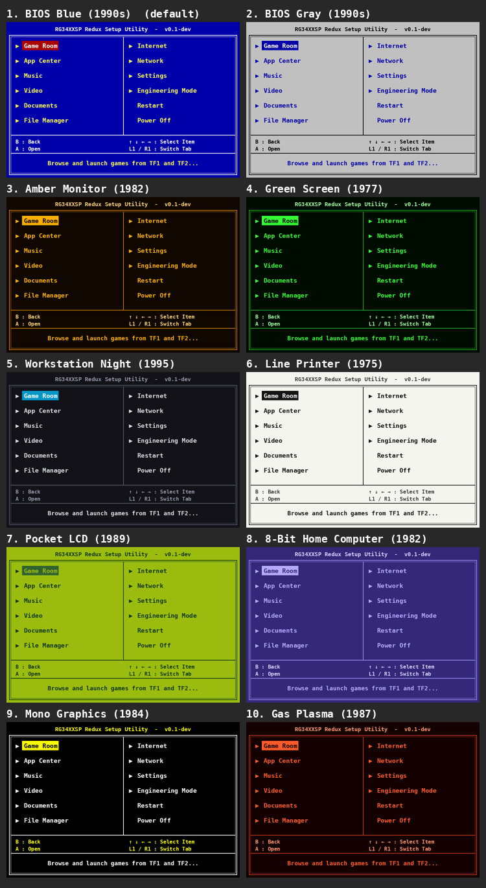

# Developer guide

How the repo is laid out and what the PC tools do. To install Redux, see [install.md](install.md); to
build the frontend, see [`frontend/README.md`](../frontend/README.md) and [build-arm.md](build-arm.md).

## Hardware at a glance

| | |
|---|---|
| SoC | Allwinner H700 (H616 family, `sun50iw9`), 4× Cortex-A53 @ up to 1.512 GHz, Mali-G31 (420-648 MHz) |
| RAM | 2 GB (the device tree's 512 MB memory node is a template that u-boot overwrites) |
| PMIC | X-Powers AXP2202 (fuel gauge, USB-C, power key; its battery temperature is a fixed dummy) |
| Display | 720×480 parallel RGB, about 59.16 Hz (exactly 3× GBA, 3× GB vertical) |
| Lid | Hall sensor on **PE7**, reported as keys on `axp2202-pek` |
| Wi-Fi/BT | Realtek RTL8821CS (SDIO) |
| Stock kernel | Linux 4.9.170 (Allwinner BSP), built 2025-04-12 |

The details are in [hardware-map.md](hardware-map.md).

## Repo layout

```
AGENTS.md, CLAUDE.md  rules for AI collaborators; they talk through notes/
notes/                dated notes (decisions, device results, sign-offs) + STATUS.md board
frontend/             the Redux menu (C/SDL2), its helpers, tests and mock-up checks
installer/            device-side install script and run.sh
branding/             boot screen, mark and colours (CC BY 4.0 artwork)
docs/                 hardware map, stock boot chain and userspace, UI brief and spec, install and user guides
docs/kernel-research/  kernel, bootloader and Ubuntu research (desk only)
reference/stock-202505/  device tree source, kernel .config, u-boot env and
                      initramfs init script, extracted from Anbernic firmware
                      rg34xxsp-fw-sd_202505 (sources only, no binaries)
tools/                PC tools (pure Python 3, no dependencies)
phase1-stock-tweaks/  baseline patch set on the stock kernel
phase2-mainline/      mainline kernel + rootfs build (planned)
```

## Tools

All of them are standard-library Python 3 and run on Windows, WSL or Linux.

| Tool | What it does |
|---|---|
| `tools/install.py` | Install, upgrade, check or uninstall Redux on a stock card over SSH ([guide](install.md)). |
| `tools/make_bootlogo.py` | Render the boot screen from `branding/` into a stock-format 640×480 BMP, or check one. |
| `tools/extras.py` | Pick optional Ubuntu extras from a checklist and get the one-line SSH install. |
| `tools/precheck.py` | Run the CI checks that matter for what you changed, before you push. |
| `tools/log_activity.py` | Append one line to `notes/ACTIVITY.md` on main (the agents' log). |
| `tools/bootimg.py` | Unpack and repack Android boot images (v0-v2). Verified to rebuild the stock `boot.img` **byte-for-byte**. |
| `tools/initramfs.py` | Unpack and repack the gzip'd cpio initramfs, keeping ownership, modes and symlinks in a manifest so a Windows checkout can't lose them. |
| `tools/dt_keys.py` | Print the button → GPIO pin → Linux event map from a device tree. |
| `tools/fdt_patch.py` | Read or overwrite a u32 property in a compiled `.dtb` in place (no `dtc` needed). |
| `tools/stock_inventory.py` | Read-only inventory of `RG34XXSP.img` with no mounting. Never reads the Roms partition. |

```bash
python3 tools/install.py --check 192.168.1.13     # what is installed?
python3 tools/install.py 192.168.1.13             # install or upgrade
python3 tools/install.py --uninstall 192.168.1.13 # back to the stock menu
```


## How Redux differs from a typical custom firmware (the goal)

| | Redux frontend | Typical custom firmware |
|---|---|---|
| **Install** | Replaces only the stock menu program, from your PC in one command | Reflash a whole OS image |
| **Undo** | `install.py --uninstall`, or *Settings → System → System Defaults → Stock Menu* on the device | Reflash stock |
| **Your existing setup** | Keeps stock RetroArch configs, saves, BIOS files and Stock OS Mod tools | Usually rebuilt from scratch |
| **Game cards** | Redux's own code never writes to, formats or resizes your ROM cards. The stock engines it launches (RetroArch, OpenBOR) keep saving there exactly as on stock, and Redux asks RetroArch to flush its saves before a lid sleep | Varies |
| **Look** | Retro BIOS-setup interface: 4 accent colours plus the 16-colour VGA palette, and 5 UI fonts, changed on the device | Theme packs |
| **Branding** | The boot screen comes from plain files in [`branding/`](../branding/) | Usually hard-coded |
| **For tinkerers** | Engineering Mode: live CPU, GPU, battery, thermal, storage and log read-outs; CPU governor, speeds and cores, always inside the chip's own tables; a heat guard | Rarely built in |
| **Footprint** | One ~250 KB program (it carries its two small helpers); about 0% CPU idle in the menu (measured 2026-11-10) | Full frontends |

## Colour presets

The build has four accent colours (BIOS cyan, Amber, Green, White) plus the 16 standard VGA text
colours (all but black) under *Settings → UI*, and five UI fonts under *Settings → Display → Font*. The
full design is ten schemes named after the displays of 1975 to the 1990s (below, a design render); those
are not built yet.

<p align="center"></p>

